# Журнал разработки TournamentManager

## 15.11.2026 — Создание проекта

Начал работу над TournamentManager в Visual Studio 2026. Использую .NET 10 и ASP.NET Core Web API. В решении предусмотрел папки `src`, `tests` и `docs`. Первый сервис — `PlayerService`, он отвечает за игроков.

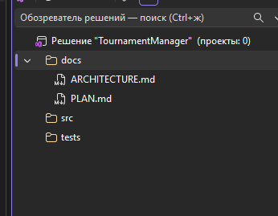

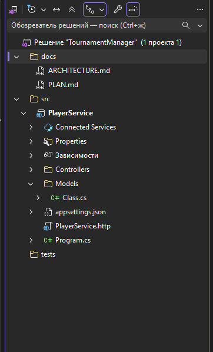

Создал модель `Player`: `Id`, `Name`, `Rating` (начальное значение — 1000) и `CreatedAt` (текущее время UTC). Затем добавил `PlayersController` с первыми запросами: получение списка игроков и создание игрока.

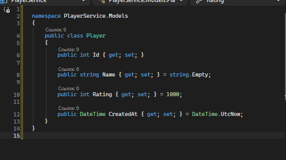

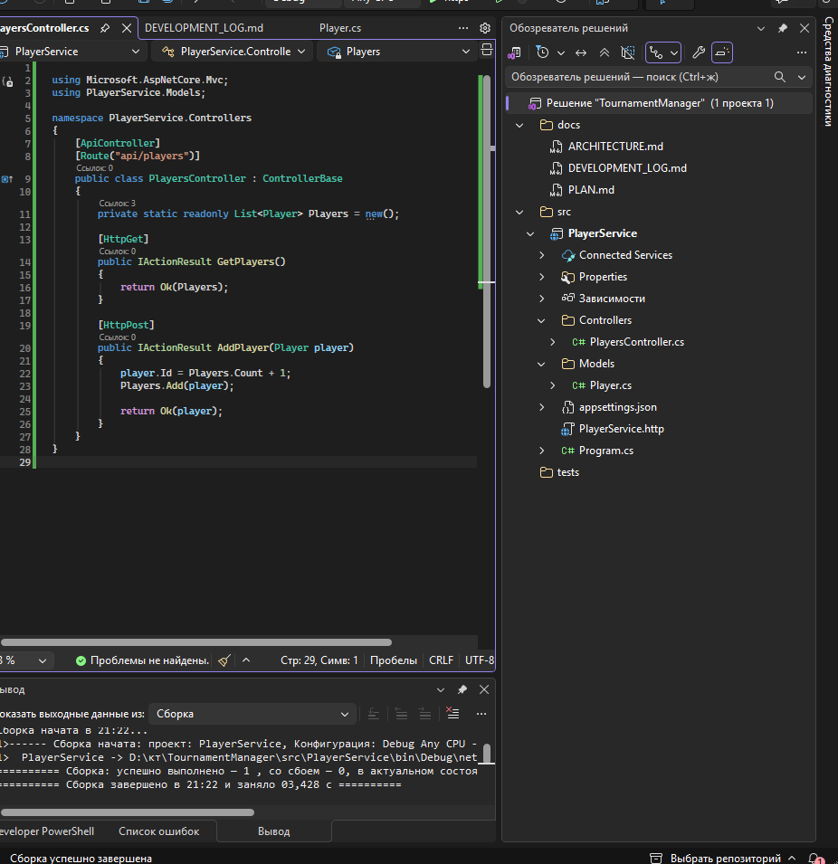

Проверил создание игрока через POST и получение списка через GET.

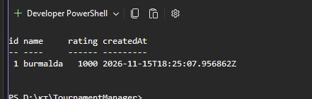

Настроил Git и создал репозиторий [tzkxwai/TournamentManager](https://github.com/tzkxwai/TournamentManager). Первый коммит: `273efd4` — `feat: initialize TournamentManager and PlayerService API`.

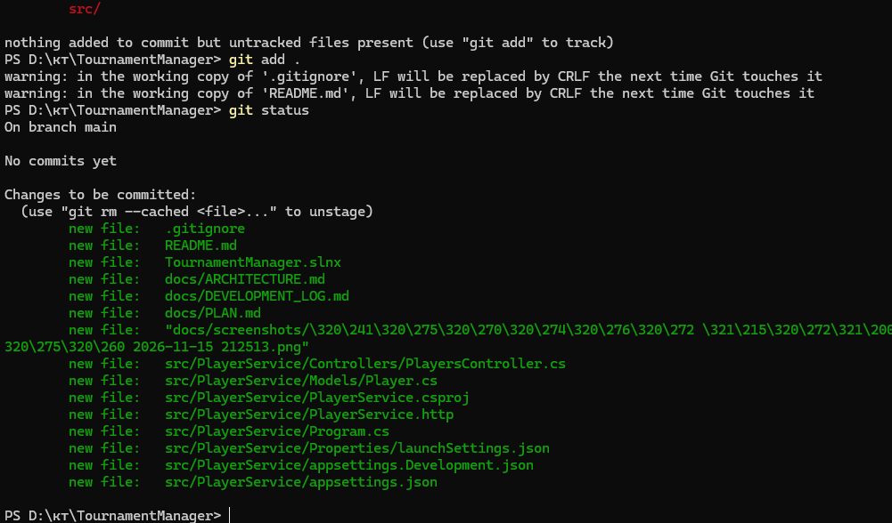

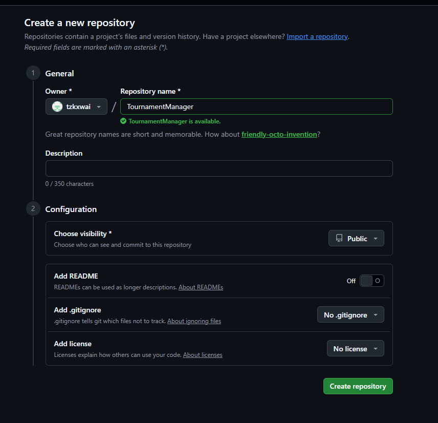

## 15.11.2026 — Подключение базы данных

Подключил SQLite через Entity Framework Core. Создал `PlayerDbContext`, зарегистрировал его в `Program.cs` и настроил строку подключения `Data Source=players.db`.

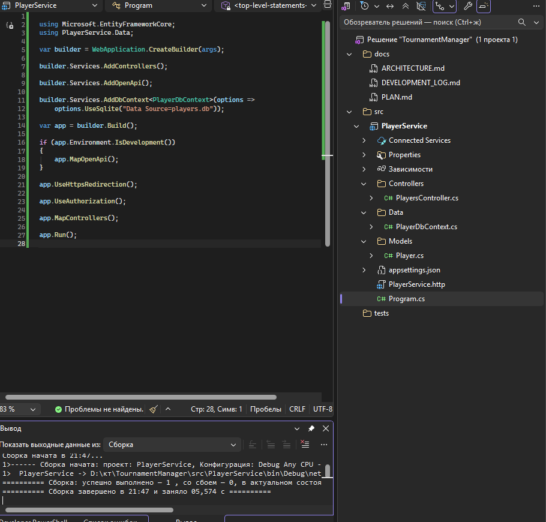

Создал миграцию `InitialCreate` и применил её:

```powershell
dotnet ef migrations add InitialCreate --project src/PlayerService/PlayerService.csproj
dotnet ef database update --project src/PlayerService/PlayerService.csproj
```

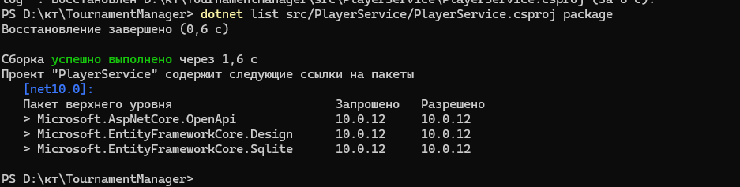

После этого перевёл `PlayersController` на работу с SQLite. Проверил, что созданный игрок остаётся в базе после перезапуска приложения. Для тестового игрока `burmalda` был назначен `Id = 1`, рейтинг — `1000`.

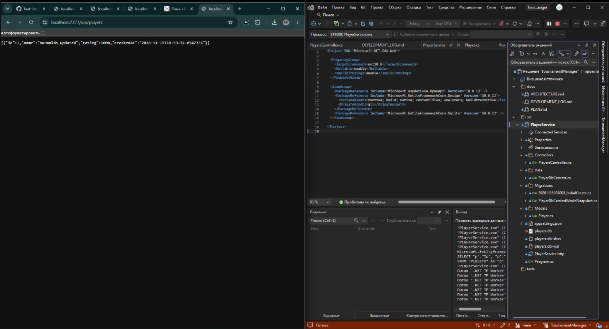

Файлы `*.db`, `*.db-shm` и `*.db-wal` добавил в `.gitignore`.

Изменения делал в ветке `feature/player-database`. Коммит: `9bb3241` (`feat: add SQLite persistence to PlayerService`). [Pull Request #1](https://github.com/tzkxwai/TournamentManager/pull/1), объединение — `e036be4`.

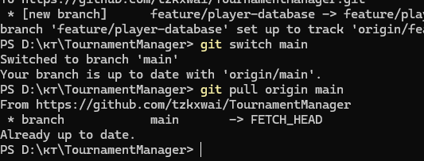

## 15.11.2026 — CRUD для игроков

Дополнил `PlayersController`. В результате сервис поддерживает пять запросов:

| Метод | Адрес | Что делает |
| --- | --- | --- |
| GET | `/api/players` | Возвращает список игроков |
| GET | `/api/players/{id}` | Возвращает игрока по ID |
| POST | `/api/players` | Создаёт игрока |
| PUT | `/api/players/{id}` | Меняет имя игрока |
| DELETE | `/api/players/{id}` | Удаляет игрока |

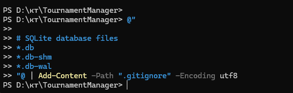

Для проверки PUT изменил имя игрока с `burmalda` на `burmalda_updated`:

```powershell
$player = @{ name = "burmalda_updated" } | ConvertTo-Json
Invoke-RestMethod -Uri "https://localhost:7277/api/players/1" -Method Put -ContentType "application/json" -Body $player
```

После GET убедился, что имя изменилось, а рейтинг `1000`, ID и дата создания остались прежними.


Для DELETE создал отдельного игрока `test_delete` с ID 2, затем удалил его:

```powershell
Invoke-RestMethod -Uri "https://localhost:7277/api/players/2" -Method Delete
```

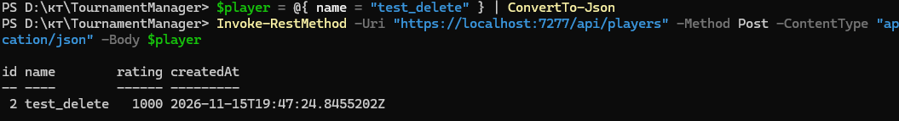


После удаления в списке остался только `burmalda_updated`.

Работал в ветке `feature/player-crud`. Коммит `2c40506` (`feat: implement player CRUD operations`), [Pull Request #2](https://github.com/tzkxwai/TournamentManager/pull/2), объединение — `af43533`. После объединения обновил локальную ветку `main`.


## 15.11.2026 — Документация

Собрал результаты работы в `docs/DEVELOPMENT_LOG.md`, добавил скриншоты запросов и структуры проекта. Документацию отправил в `main` коммитом `a19a352` — `docs: update development log and add screenshots`.

## 15.11.2026 — Автоматические тесты

Создал ветку `feature/player-tests`. В папке `tests` появился проект `PlayerService.Tests` на .NET 10 с xUnit. Добавил его в `TournamentManager.slnx` и подключил ссылку на `PlayerService`.

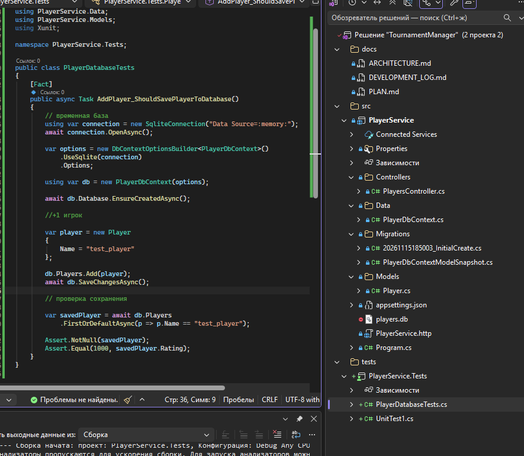

Сначала проверил модель `Player`:

- `NewPlayer_ShouldHaveDefaultRating` — начальный рейтинг равен 1000.
- `NewPlayer_ShouldHaveCreationDate` — `CreatedAt` выставляется при создании игрока.

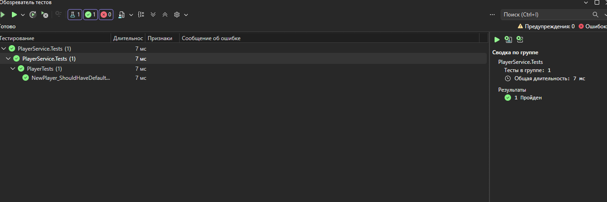

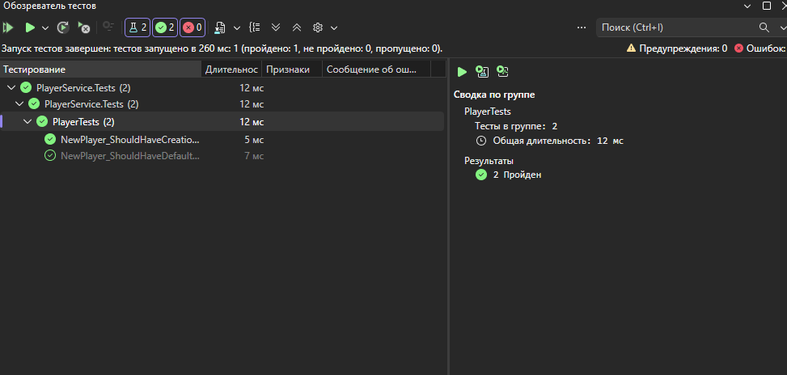

Затем добавил четыре теста работы с SQLite:

- `AddPlayer_ShouldSavePlayerToDatabase` — добавление записи.
- `GetPlayer_ShouldReadPlayerFromDatabase` — чтение через новый экземпляр `PlayerDbContext`.
- `UpdatePlayer_ShouldSaveNewName` — сохранение изменённого имени.
- `DeletePlayer_ShouldRemovePlayerFromDatabase` — удаление записи.

Во всех тестах базы данных используется SQLite в памяти (`Data Source=:memory:`). Соединение остаётся открытым на время теста, поэтому несколько контекстов могут работать с одной временной базой. Файл `players.db` не меняется.

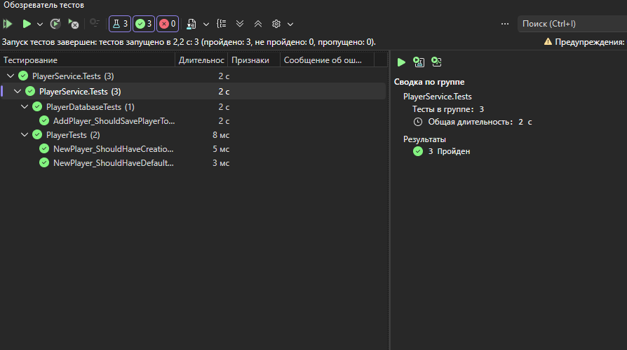

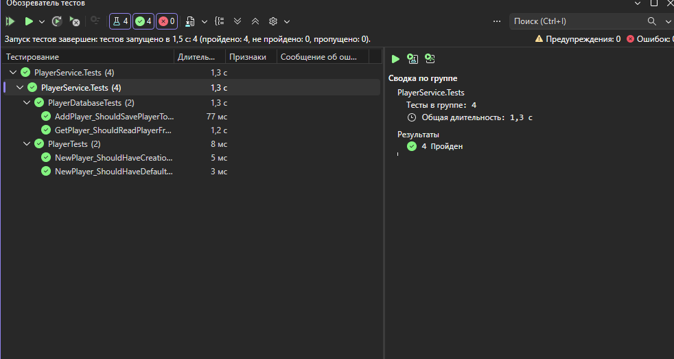

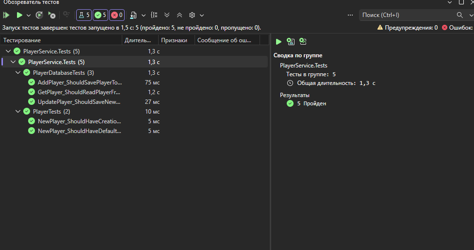

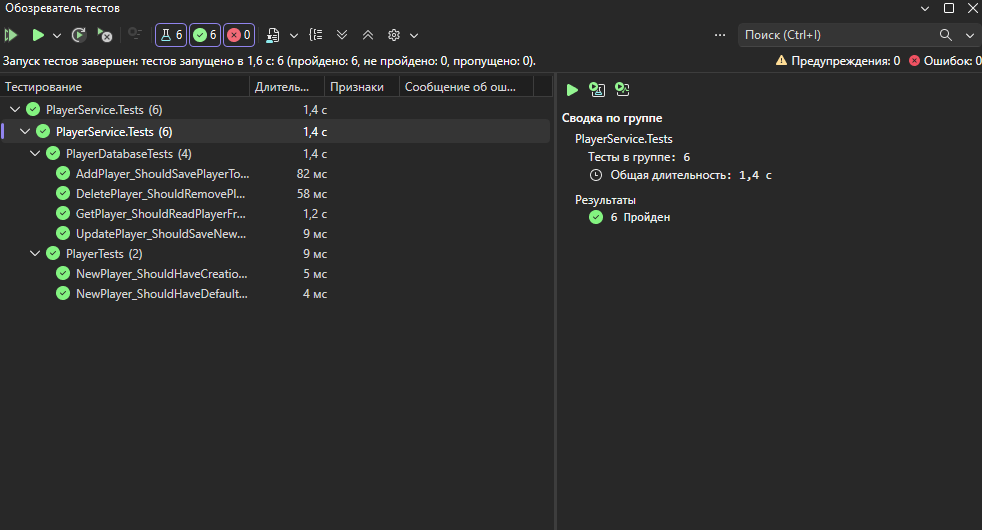

Итог последнего запуска в Visual Studio: **6 тестов пройдено, 0 ошибок, 0 пропущено**. Время выполнения — около 1,4 секунды.

Это пока тесты модели и работы EF Core с SQLite. Методы HTTP-контроллера отдельно автоматическими тестами ещё не покрыты.

Проверил изменения в Git. В коммит подготовлены `TournamentManager.slnx` и три файла тестового проекта; файлы сборки `bin` и `obj` не добавлялись.

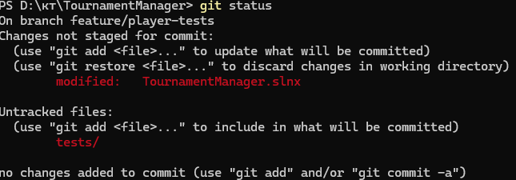

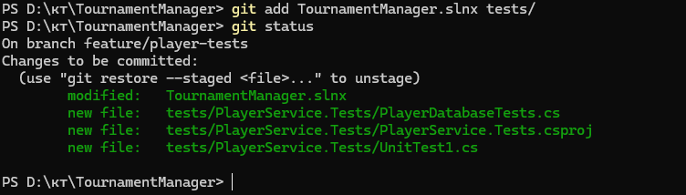

**Состояние на момент записи:** ветка `feature/player-tests`, файлы тестов подготовлены к коммиту. Коммит и Pull Request для этой ветки ещё не созданы.

## Что дальше

Следующий шаг — сохранить тесты и обновлённый журнал в Git, отправить ветку на GitHub и создать Pull Request #3. После этого можно написать отдельные тесты `PlayersController` и приступить к `TournamentService`.
