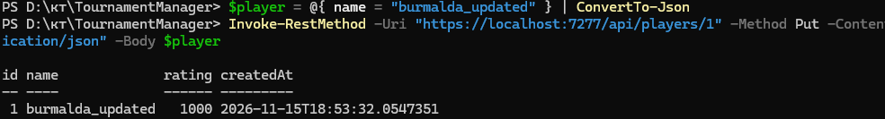
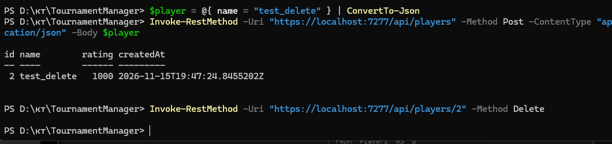
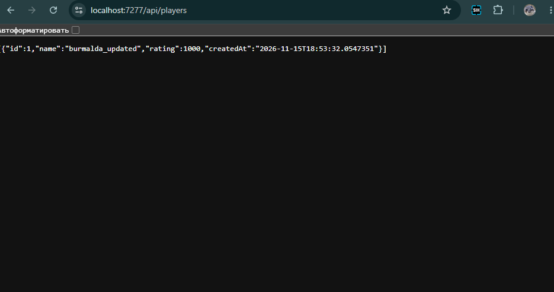

Создал проект TournamentManager в Visual Studio 2026 на платформе .NET 10.

Подготовил структуру проекта с папками src, tests и docs.

В папке src создал ASP.NET Core Web API приложение PlayerService для работы с игроками.

Создал модель Player с полями:
- Id — идентификатор игрока;
- Name — имя игрока;
- Rating — рейтинг, по умолчанию 1000;
- CreatedAt — дата создания игрока.

Добавил PlayersController и реализовал первые два запроса:
- GET /api/players — получение списка игроков;
- POST /api/players — создание игрока.

Настроил Git и создал репозиторий на GitHub.

Коммит: 273efd4
feat: initialize TournamentManager and PlayerService API

### Скриншот структуры проекта

## 15.11.2026 — Подключение SQLite

Подключил SQLite с помощью Entity Framework Core.

Создал PlayerDbContext и настроил подключение к базе данных в Program.cs.

Создал миграцию InitialCreate и применил её командами:

    dotnet ef migrations add InitialCreate --project src/PlayerService/PlayerService.csproj

    dotnet ef database update --project src/PlayerService/PlayerService.csproj

Изменил PlayersController, чтобы игроки сохранялись в SQLite, а не в оперативной памяти приложения.

Добавил файлы базы данных в .gitignore.

### Проверка

Через POST-запрос создал игрока burmalda.

Полученные данные:
- Id: 1
- Name: burmalda
- Rating: 1000
- CreatedAt: 2026-11-15T18:53:32.0547351

После перезапуска приложения игрок остался в базе данных.

Проверил получение игроков через GET /api/players.

### Скриншот

### Git

Ветка: feature/player-database

Коммит: 9bb3241
feat: add SQLite persistence to PlayerService

Pull Request #1:
https://github.com/tzkxwai/TournamentManager/pull/1

Коммит объединения: e036be4

## 15.11.2026 — Реализация CRUD

Продолжил разработку PlayerService.

Добавил получение игрока по ID, изменение имени и удаление игрока.

Реализованные методы:

| Метод | Адрес | Назначение |
|---|---|---|
| GET | /api/players | Получение всех игроков |
| GET | /api/players/{id} | Получение игрока по ID |
| POST | /api/players | Создание игрока |
| PUT | /api/players/{id} | Изменение имени игрока |
| DELETE | /api/players/{id} | Удаление игрока |

### Проверка GET

Открыл адрес:

https://localhost:7277/api/players/1

Сервер вернул данные игрока burmalda с ID 1.

### Проверка PUT

В PowerShell выполнил команды:

    $player = @{ name = "burmalda_updated" } | ConvertTo-Json

    Invoke-RestMethod -Uri "https://localhost:7277/api/players/1" -Method Put -ContentType "application/json" -Body $player

Имя игрока изменилось с burmalda на burmalda_updated.

Рейтинг остался равен 1000.

ID и дата создания также не изменились.

После повторного GET-запроса убедился, что новое имя сохранилось в SQLite.

### Скриншот PUT

### Проверка DELETE

Создал тестового игрока:
- Id: 2
- Name: test_delete
- Rating: 1000

Для удаления выполнил команду:

    Invoke-RestMethod -Uri "https://localhost:7277/api/players/2" -Method Delete

Команда выполнилась без ошибок.

После удаления открыл:

https://localhost:7277/api/players

В списке остался только игрок burmalda_updated.

Тестовый игрок test_delete был удалён из базы данных.

### Скриншоты DELETE

### Git

Ветка: feature/player-crud